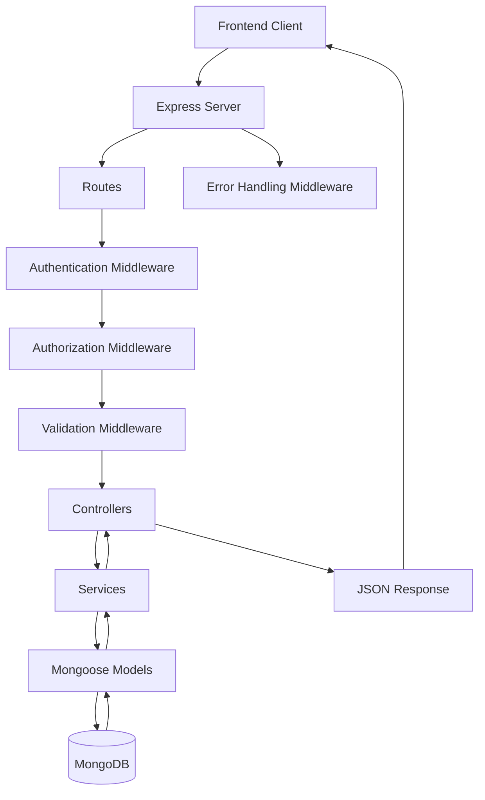

# HCM Lite — Backend

A RESTful backend API for HCM Lite, a Human Capital Management system designed to support employee management, attendance tracking, leave management, payroll processing, company settings, announcements, notifications, and audit logging.

The backend follows a modular architecture that separates routing, controllers, business logic, database models, middleware, and shared utilities.

## Table of Contents

- Overview
- Features
- Technology Stack
- Backend Architecture
- Project Structure
- Request Lifecycle
- API Modules
- Authentication and Authorization
- Database Models
- Middleware
- Error Handling
- Environment Variables
- Installation and Setup
- Running the Server
- API Response Handling
- Security Considerations
- Development Guidelines

## Overview

HCM Lite Backend provides the API and business logic required by the HCM Lite frontend.

It receives HTTP requests, validates input, authenticates users, checks permissions, executes business operations, communicates with MongoDB, and returns JSON responses.

The application is organized into feature-based route and controller modules, with services responsible for reusable business logic.

## Features

### 1. Authentication and User Management

- User login and authentication.
- JWT-based authentication.
- Password hashing and verification.
- Protected API endpoints.
- Temporary-password handling, where configured.
- User management and account status operations.
- Role-based access control.

### 2. Employee Management

- Create and manage employee records.
- Retrieve employee information.
- Update employee details.
- Manage employment and joining information.
- Support employee-related administrative operations.

### 3. Attendance Management

- Employee check-in and check-out.
- Personal attendance history.
- Monthly attendance calendars.
- Attendance board for authorized users.
- Attendance correction requests.
- Review and approve or reject correction requests.
- Working-day and attendance-status calculations.

### 4. Leave Management

- Leave request creation and retrieval.
- Leave type management.
- Leave balance calculations.
- Leave approval and rejection.
- Paid and unpaid leave handling.
- Working-day and holiday calculations.

### 5. Payroll Management

- Salary structure management.
- Monthly payroll draft generation.
- Payslip calculation and storage.
- Gross salary and net salary calculations.
- Attendance and unpaid-leave deductions.
- Illustrative tax calculations.
- Payroll finalization and protection of finalized runs.

**Note:** Tax calculations must be reviewed and adapted to applicable tax laws before being used for real payroll processing.

### 6. Company Management

- Company configuration.
- Weekend settings.
- Holiday management.
- Shared company-related business rules.

### 7. Dashboard

- Admin dashboard data.
- HR dashboard data.
- Employee dashboard data.
- Attendance, leave, payroll, and other relevant summaries.

### 8. Announcements and Notifications

- Create and retrieve announcements.
- Delete announcements according to permissions.
- Create user notifications.
- Send notifications to multiple users.
- Retrieve notification-related information through the API.

### 9. Audit Logging

- Record relevant application activities.
- Store audit log entries.
- Provide audit information to authorized users.

### 10. API Validation and Pagination

- Request validation middleware.
- Query parameter validation.
- Date and month validation utilities.
- Pagination helpers.
- Consistent application error handling.

## Technology Stack

| Technology | Purpose |
|---|---|
| Node.js | JavaScript runtime |
| Express.js | REST API and HTTP routing |
| MongoDB | Document-oriented database |
| Mongoose | Database models, schemas, and queries |
| JSON Web Token (JWT) | Token-based authentication |
| bcrypt | Password hashing, if configured in the project |
| dotenv | Environment variable configuration |
| CORS | Cross-origin request configuration |
| JavaScript ES Modules | `import` and `export` module system |

The exact package versions and installed dependencies are defined in `package.json`.

## Backend Architecture

HCM Lite uses a layered backend architecture. Each layer has a distinct responsibility to keep the application maintainable, testable, and easier to extend.

### Architecture Diagram



The exact middleware order depends on the route and the server configuration. Errors are passed to the centralized error handler when applicable.

### 1. Routes Layer

**Directory:** `src/routes/`

Routes define the API endpoints and map incoming HTTP requests to controller methods.

Responsibilities:

- Define HTTP methods and endpoint paths.
- Apply authentication middleware.
- Apply role-based authorization.
- Apply request validation.
- Connect endpoints to controller functions.

Example:

```js
router.get("/", protect, controller.list);
```

### 2. Controllers Layer

**Directory:** `src/controllers/`

Controllers handle incoming requests and prepare HTTP responses.

Responsibilities:

- Read route parameters, query parameters, and request bodies.
- Call the appropriate service functions.
- Return JSON responses and HTTP status codes.
- Pass errors to the error-handling middleware.

Controllers should avoid duplicating complex business logic.

### 3. Services Layer

**Directory:** `src/services/`

Services contain reusable business rules and application operations.

Responsibilities:

- Execute business workflows.
- Coordinate database operations.
- Calculate attendance and leave information.
- Generate payroll drafts and payslips.
- Apply company-specific rules.
- Coordinate operations across multiple models.

Keeping business logic in services reduces duplication and makes it easier to test independently of HTTP requests.

### 4. Models Layer

**Directory:** `src/models/`

Mongoose models define the application's data structures and provide database access.

Responsibilities:

- Define document schemas.
- Specify field types and validation rules.
- Define relationships using document references.
- Perform database queries and updates through Mongoose.

### 5. Middleware Layer

**Directory:** `src/middleware/`

Middleware functions run during the request lifecycle.

Responsibilities:

- Authenticate requests.
- Authorize user roles.
- Validate request data.
- Handle errors.
- Reject invalid or unauthorized requests.

### 6. Utilities Layer

**Directory:** `src/utils/`

Utilities provide shared functions used across modules.

Examples include:

- Date formatting and date-range helpers.
- Working-day calculations.
- Month-range calculations.
- Currency and numerical rounding helpers.
- Pagination utilities.
- Custom API error classes.
- JWT generation utilities.

## Project Structure

The following structure reflects the backend modules and filenames used in the previously shared code. Some supporting files may differ in the actual repository.

```text
backend/
├── src/
│   ├── controllers/
│   │   ├── authController.js
│   │   ├── userController.js
│   │   ├── employeeController.js
│   │   ├── attendanceController.js
│   │   ├── leaveController.js
│   │   ├── payrollController.js
│   │   ├── companyController.js
│   │   ├── dashboardController.js
│   │   ├── announcementController.js
│   │   ├── notificationController.js
│   │   └── auditController.js
│   │
│   ├── routes/
│   │   ├── authRoutes.js
│   │   ├── employeeRoutes.js
│   │   ├── attendanceRoutes.js
│   │   ├── leaveRoutes.js
│   │   ├── payrollRoutes.js
│   │   ├── companyRoutes.js
│   │   ├── dashboardRoutes.js
│   │   ├── announcementRoutes.js
│   │   ├── notificationRoutes.js
│   │   └── auditRoutes.js
│   │
│   ├── services/
│   │   ├── attendanceService.js
│   │   ├── auditService.js
│   │   ├── companyService.js
│   │   ├── dashboardService.js
│   │   ├── leaveService.js
│   │   ├── notificationService.js
│   │   └── payrollService.js
│   │
│   ├── models/
│   │   ├── User.js
│   │   ├── Employee.js
│   │   ├── Attendance.js
│   │   ├── LeaveRequest.js
│   │   ├── LeaveType.js
│   │   ├── SalaryStructure.js
│   │   ├── PayrollRun.js
│   │   ├── Payslip.js
│   │   ├── Company.js
│   │   ├── Holiday.js
│   │   ├── Announcement.js
│   │   ├── Notification.js
│   │   └── AuditLog.js
│   │
│   ├── middleware/
│   │   ├── authMiddleware.js
│   │   ├── roleMiddleware.js
│   │   ├── validateMiddleware.js
│   │   ├── errorMiddleware.js
│   │   └── notFoundMiddleware.js
│   │
│   ├── utils/
│   │   ├── ApiError.js
│   │   ├── dates.js
│   │   ├── generateToken.js
│   │   └── pagination.js
│   │
│   ├── config/
│   │   └── database.js
│   │
│   └── server.js
│
├── .env.example
├── .gitignore
├── package.json
├── package-lock.json
└── README.md
```

**Architecture notes:**

- `controllers/` handle HTTP requests and responses.
- `routes/` define endpoints and attach middleware.
- `services/` contain reusable business operations.
- `models/` define MongoDB document schemas.
- `middleware/` handles authentication, permissions, validation, and errors.
- `utils/` contains reusable helpers.
- `config/` contains configuration modules, such as database connection setup.
- `server.js` initializes and starts the application.

The `config/database.js` path is illustrative; use the actual database connection file from your repository.

## Request Lifecycle

A typical request follows these steps:

1. The frontend sends an HTTP request to the backend API.
2. Express matches the request to a route.
3. Authentication middleware verifies the user when the endpoint is protected.
4. Authorization middleware checks the user's permitted role or access level.
5. Validation middleware checks the required request data.
6. The controller receives the validated request and calls the relevant service.
7. The service applies business rules and interacts with Mongoose models.
8. MongoDB processes the required database operations.
9. The controller returns the response.
10. If an error occurs, the error-handling middleware returns an appropriate error response.

Not every route uses every middleware layer. Public routes and simpler operations may have a shorter request lifecycle.

## API Modules

The following modules represent the main backend areas. Exact endpoint paths and HTTP methods should be confirmed against the route files.

| Module | Purpose |
|---|---|
| Authentication | Login and authentication-related operations |
| Users | User management and account administration |
| Employees | Employee records and employment information |
| Attendance | Check-in, check-out, attendance boards, and corrections |
| Leaves | Leave requests, balances, and approvals |
| Payroll | Salary structures, payroll runs, and payslips |
| Company | Company configuration and holidays |
| Dashboard | Role-specific dashboard summaries |
| Announcements | Company announcements |
| Notifications | User notifications |
| Audit | Audit log retrieval and activity tracking |

## Authentication and Authorization

### JWT Authentication

The backend uses JSON Web Tokens for authentication, according to the shared authentication utilities.

The token utility signs a payload containing the user ID and reads the secret and expiry duration from environment variables.

Protected endpoints use authentication middleware to verify credentials and identify the current user.

### Role-Based Authorization

Role-based middleware restricts access to endpoints based on user permissions.

Example roles include:

- `admin`
- `hr`
- `employee`

Individual endpoints may require one or more specific roles.

### Password Security

Passwords should be hashed before storage and verified securely during login. Plain-text passwords must never be stored or returned in API responses.

### Important Security Rule

Frontend restrictions are not sufficient to protect backend resources. Authentication and authorization must be enforced by the backend for every protected operation.

## Database Models

The backend uses Mongoose models to represent HR-related data in MongoDB.

| Model | Responsibility |
|---|---|
| User | Authentication and user account information |
| Employee | Employee and employment information |
| Attendance | Attendance records and statuses |
| LeaveRequest | Employee leave applications and decisions |
| LeaveType | Leave categories and paid/unpaid settings |
| SalaryStructure | Employee salary components |
| PayrollRun | Monthly payroll processing status and totals |
| Payslip | Employee payroll calculation records |
| Company | Company-level configuration |
| Holiday | Public and company holiday records |
| Announcement | Company announcements |
| Notification | User notifications |
| AuditLog | Application activity records |

Models may reference other documents through MongoDB ObjectIds. Actual fields, indexes, validation constraints, and relationships are defined in the corresponding schema files.

## Middleware

### Authentication Middleware

Verifies JWT credentials and identifies the authenticated user. Protected routes use this middleware where required.

### Role Middleware

Checks whether the authenticated user has permission to perform the requested operation.

### Validation Middleware

Validates incoming request fields and query parameters according to the rules configured for each route.

### Not-Found Middleware

Handles requests that do not match any registered route and returns an appropriate not-found response.

### Error Middleware

Handles errors passed through the Express error-handling pipeline and formats error responses consistently.

## Error Handling

The backend uses a custom `ApiError` class to represent application errors with an HTTP status and optional error code.

Example:

```js
class ApiError extends Error {
  constructor(status, message, code) {
    super(message);
    this.status = status;
    this.code = code;
  }
}

export default ApiError;
```

Services and controllers can throw or forward application errors to the centralized error middleware.

Typical HTTP status codes include:

| Status | Meaning |
|---|---|
| 400 | Bad Request or validation failure |
| 401 | Authentication required or invalid |
| 403 | Access forbidden |
| 404 | Resource or route not found |
| 409 | Conflict, where applicable |
| 500 | Internal Server Error |

The exact response body depends on the implementation of the error middleware.

## Environment Variables

Create a `.env` file in the backend root directory.

Example:

```env
PORT=5000
NODE_ENV=development

MONGODB_URI=mongodb://127.0.0.1:27017/hcm-lite

JWT_SECRET=replace_with_a_secure_random_secret
JWT_EXPIRES_IN=7d

FRONTEND_URL=http://localhost:5173
```

These variable names are examples. Use the exact names referenced in your source code.

### Environment Variable Guidelines

- Keep secrets in environment variables.
- Do not commit `.env` files to Git.
- Provide a `.env.example` file with placeholder values.
- Use a strong, unpredictable JWT secret.
- Restrict database access appropriately.
- Configure CORS for the actual frontend origin.
- Never expose backend secrets to the frontend.

## Installation and Setup

### Prerequisites

- Node.js installed.
- npm installed.
- MongoDB running locally or accessible through a MongoDB connection URI.
- Environment variables configured.

### 1. Clone the Repository

```bash
git clone <repository-url>
```

Replace `<repository-url>` with the actual repository URL.

### 2. Navigate to the Backend Directory

```bash
cd backend
```

### 3. Install Dependencies

```bash
npm install
```

### 4. Configure Environment Variables

Create the `.env` file and add the configuration required by the application.

### 5. Start the Backend

Run the command configured in the `scripts` section of `package.json`.

For example, if a development script is configured:

```bash
npm run dev
```

If a production start script is configured:

```bash
npm start
```

Use the commands actually defined by your project.

## ES Modules

The backend uses the ES Modules syntax for JavaScript imports and exports.

The `package.json` should include:

```json
{
  "type": "module"
}
```

Use `import` and `export` instead of CommonJS `require()` and `module.exports`.

For relative imports, include the `.js` extension where required by Node.js ES Modules.

Example:

```js
import ApiError from "../utils/ApiError.js";
import { todayStr, eachDay } from "../utils/dates.js";

export { todayStr, eachDay };
```

Make sure default and named exports match their corresponding imports.

## API Response Handling

The API should return appropriate HTTP status codes and JSON responses.

A successful response may look like:

```json
{
  "success": true,
  "message": "Operation completed successfully",
  "data": {}
}
```

An error response may look like:

```json
{
  "success": false,
  "message": "Invalid request"
}
```

These are illustrative response formats. The actual structure must match the response objects implemented by your controllers and error middleware.

## Security Considerations

- Hash passwords securely.
- Validate all client-provided data on the backend.
- Verify JWTs on protected routes.
- Enforce role-based permissions on sensitive operations.
- Never return passwords, password hashes, JWT secrets, or other private credentials.
- Configure CORS for trusted frontend origins.
- Avoid exposing stack traces in production.
- Use HTTPS in production.
- Protect employee, attendance, and payroll information from unauthorized access.
- Keep dependencies updated and review security advisories.
- Apply appropriate request limits and logging policies for production.

## Development Guidelines

- Keep route definitions separate from business logic.
- Keep controllers focused on request and response handling.
- Put reusable business rules in services.
- Use Mongoose models for database operations.
- Use shared utilities for repeated calculations and formatting.
- Use consistent error handling.
- Validate request data before processing it.
- Avoid duplicating business logic across controllers.
- Keep module imports and exports consistent.
- Test affected endpoints after making changes.

## Testing

Before deploying changes, verify the affected API endpoints.

Recommended testing areas:

- Authentication and invalid credentials.
- Role-based access restrictions.
- Request validation.
- Employee record operations.
- Attendance calculations and correction workflows.
- Leave balances and approval workflows.
- Payroll calculations and finalized payroll protection.
- Database connection failures.
- Centralized error handling.

Use automated tests and an API client where available.

## Deployment

Before deploying to production:

1. Configure production environment variables.
2. Use a secure MongoDB connection.
3. Set the correct frontend origin in CORS.
4. Use a strong JWT secret.
5. Run the production startup command.
6. Verify the health and availability of required services.
7. Test authentication, authorization, and critical API workflows.
8. Avoid exposing secrets or sensitive diagnostic information.

## Future Improvements

Potential improvements include:

- Automated unit and integration tests.
- API documentation using OpenAPI or Swagger.
- Request rate limiting.
- Structured application logging.
- Database indexes and query optimization.
- Health-check endpoints.
- CI/CD pipelines.
- Improved monitoring and production diagnostics.

## License

Add the appropriate license information before distributing this project publicly.

---

**HCM Lite Backend** — A modular REST API for employee and human resource management.
